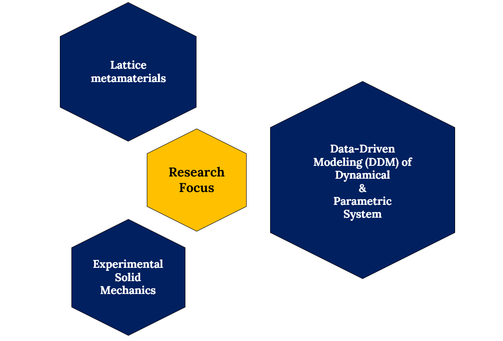

  <iframe width="560" height="315" src="https://www.youtube.com/embed/Qzz7_pR2uK4" title="Energy-closure POD" frameborder="0" allow="accelerometer; autoplay; clipboard-write; encrypted-media; gyroscope; picture-in-picture; web-share" referrerpolicy="strict-origin-when-cross-origin" allowfullscreen></iframe>

------------------------------------------------------------------------

### Abstract

We study the reduced order modeling of a piecewise-linear, globally nonlinear flexible oscillator in which a Bernoulli–Euler beam is subjected to a position-triggered kick force and a piecewise restoring force at its tip. The nonsmooth boundary conditions, which determine different regions of a hybrid phase space, can generally be expected to excite many degrees of freedom. With kick strength as parameter, the system’s bifurcation diagram is found to exhibit a range of periodic and chaotic behaviors. Proper orthogonal decomposition (POD) is used to obtain a single set of global basis functions spanning all of the hybrid regions. The reduced order model (ROM) dimension is chosen using previously developed energy closure analysis, ensuring approximate energy balance on the reduced subspace. This yields accurate ROMs with 8 degrees of freedom. Remarkably, we find that ROMs formulated using data from individual periodic steady states can nevertheless be used to reconstruct the entire bifurcation structure of the original system without updating. This demonstrates that, despite being constructed with steady state data, the ROMs model sufficiently small transients with enough accuracy to permit using simple continuation for the bifurcation diagram. We also find ROM subspaces obtained for different values of the bifurcation parameter are essentially identical. Thus, POD augmented with energy closure analysis is found to reliably yield effective dimension estimates and ROMs for this nonlinear, nonsmooth system that are robust across stability transitions, including even period doubling cascades to chaos, thereby greatly reducing data requirements and computational costs.
<!-- ------------------------------------------------------------------------ -->

<!-- ### Article PDF -->

<!-- <iframe src="model_reduction.pdf" width="100%" height="800px" style="border: 1px solid #ddd;"> -->

<!-- </iframe> -->
